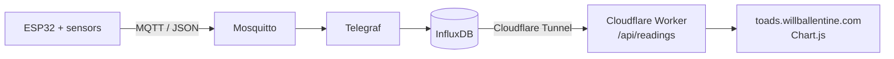

# Toad Weather Station


An ESP32 sensor node that monitors the habitat of my two southern toads, Big Momma and Jessica Gwinn Jr., and streams readings to a self-hosted time-series stack and a public web page.

**Live data:** [toads.willballentine.com](https://toads.willballentine.com)

## Architecture



- **Edge:** ESP32 reads the sensors every 5 min, timestamps with NTP (UTC), and publishes JSON over MQTT.
- **Server:** Mosquitto, Telegraf, InfluxDB and Grafana run in Docker on an always-on home machine.
- **API:** a Cloudflare Worker queries InfluxDB through a Cloudflare Tunnel (service-token auth) and returns downsampled series (24 h raw, 7 d 30-min means, 30 d 2-h means), cached for 60 s. Source: [`worker/toads.js`](https://github.com/Will-ballentine/willballentine.com/blob/main/worker/toads.js) in the website repo.
- **Front end:** static page with live tiles (stale warning after 15 min) and collapsible, lazy-loaded Chart.js graphs. Times are converted to Pacific only at display.

## Hardware

| Sensor | Measures | Interface | ESP32 pin |
|---|---|---|---|
| DS18B20 (waterproof) | Soil temperature | 1-Wire | GPIO 4 |
| Capacitive soil moisture v1.2 | Soil moisture | Analog, 3.3 V | GPIO 34 (ADC1) |
| BME280 | Air temp, humidity, pressure | I2C, 0x76 | SDA 21 / SCL 22 |

Board: uPesy ESP32 WROOM DevKit, USB powered. The moisture sensor sits on ADC1 because ADC2 pins stop working while WiFi is active.

## Firmware

PlatformIO, Arduino framework. Libraries: OneWire, DallasTemperature, Adafruit BME280, ArduinoJson 7, PubSubClient.

Design choices:
- **No data without a valid clock:** readings are not published until NTP has synced, so the database never gets 1970 timestamps.
- **Failed sensors send `null`**, not a sentinel value, and the BME280 is re-initialized on each reading if it dropped out.
- **Online/offline status** via a retained MQTT message and Last Will, so the server knows when the device disappears.
- **Self-healing connections:** WiFi and MQTT reconnect on their own; ADC reads are averaged (16 samples) to tame ESP32 noise.

### Payload

Topic `toadtank/station1/sensors`:

```json
{"ts":1795425600,"soil_temp_c":22.31,"air_temp_c":23.05,"humidity_pct":71.4,
 "pressure_hpa":1012.6,"soil_moisture_raw":2210,"soil_moisture_pct":46,
 "uptime_s":86400,"rssi_dbm":-58}
```

### Build and flash

```bash
cd firmware
cp include/secrets.example.h include/secrets.h   # add WiFi + broker IP
pio run -t upload && pio device monitor
```

## Server

`server/env.example` lists the variables the Docker stack expects (copy to `server/.env`). The compose file and Telegraf config are being added.

## Roadmap

- [ ] Add docker-compose and Telegraf config to `server/`
- [ ] Filter sensor spikes (bad air-temp readings logged during installation)
- [ ] Calibrate soil moisture in substrate
- [ ] MQTT authentication, watchdog, OTA updates, alerts, InfluxDB backups
- [ ] Camera: Raspberry Pi 5 + NoIR camera streaming over RTSP, with OpenCV activity tracking published back to MQTT alongside the sensor data

## License

MIT
